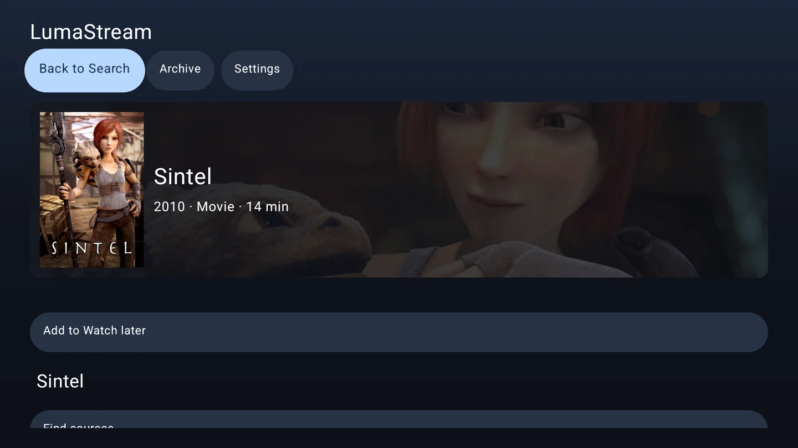
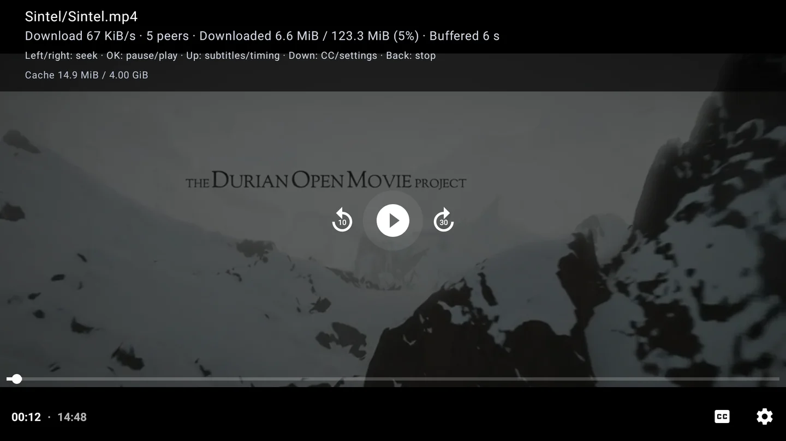
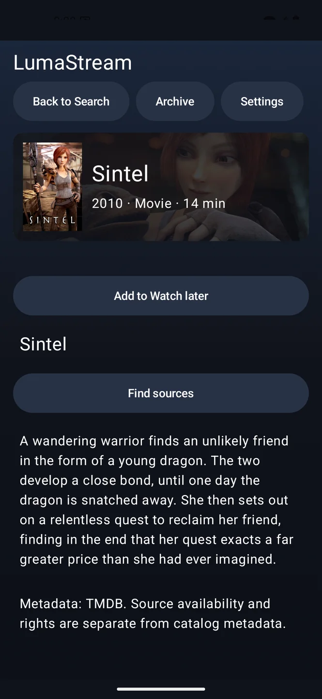
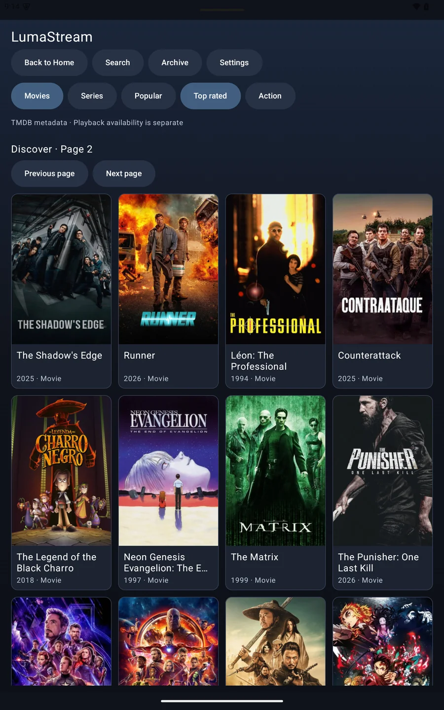

# LumaStream

### From discovery to playback. One Android app.

Open a magnet link or torrent without registering, or connect an optional movie catalog, and start watching **before the download finishes**. LumaStream runs on your TV, phone or tablet — with the torrent engine built in, not on a separate server.

**[Download v0.9.0 preview](https://github.com/valdisd96/lumastream/releases/tag/v0.9.0)** · [Getting started](#getting-started) · [What's new](docs/releases/0.9.0.md) · [Report a problem](https://github.com/valdisd96/lumastream/issues)

**Android 9+ · Android TV / Google TV · Phones & tablets · No separate streaming server**



*The TV catalog, captured on a Google TV emulator. More real screenshots below.*

## Why LumaStream?

- **Start without accounts.** Open magnet links, HTTPS torrent URLs or `.torrent` documents. Optionally connect TMDB to search movies and series, browse collections and explore genres.
- **Keep your place.** Save titles to Watch later and return to your viewing history, with separate resume points for each episode.
- **Choose how to play.** Pick a source yourself, or choose a quality/language group and let automatic selection try available candidates.
- **Watch your way.** TV remote and touch controls, seeking, audio-track selection, subtitles and subtitle timing adjustment.
- **Use less disk space.** A rolling torrent cache means the whole video does not have to fit on your device. Choose a 1, 2, 4 or 8 GiB cache in Settings.
- **Keep it self-contained.** One APK, an embedded torrent engine, and no mandatory companion server or catalog account. Network playback still needs internet access; optional services receive requests when used.

LumaStream is a **preview**, not a subscription streaming service. It does not include movies, credentials or guaranteed sources. Only play content you are authorized to obtain and share.

## See it in action



**Playback before the full download.** The published v0.8.0 APK on an XGIMI MoGo 4 Laser: a rendered Sintel frame at 00:12, with 6.6 MiB of 123.3 MiB downloaded. This is a real device capture, not a mockup or a startup-speed benchmark.

<p align="center">
  
  
</p>

**Small screen, same library features.** Title details on a phone and discovery on a tablet, captured on ARM64 emulators. Settings and library data are local to each installation; there is no cross-device sync.

Screenshots use real app screens. Sintel © Blender Foundation, [CC BY 3.0](https://creativecommons.org/licenses/by/3.0/). [Capture details and artwork credits](docs/images/README.md).

## Getting started

### 1. Install the APK

1. Open the **[v0.9.0 download page](https://github.com/valdisd96/lumastream/releases/tag/v0.9.0)** and expand **Assets** if needed.
2. Download **`lumastream-0.9.0-universal.apk`**. The same file supports TVs, phones and tablets running Android 9 or newer.
3. On a phone/tablet, open the downloaded APK. On a TV, transfer it to the TV and open it with an APK installer or file manager.
4. If Android asks, allow **Install unknown apps** for the app opening the APK, then install LumaStream. You can turn that permission off afterward.

**Updating?** Install over an earlier signed LumaStream release without uninstalling to keep settings and history. Development/debug builds use a different signing key and cannot be updated this way. **Uninstalling deletes local settings and history** — do not uninstall just to dismiss a signature error.

<details>
<summary>Optional: verify the download or install with ADB</summary>

Download `SHA256SUMS` from the same release into the APK's folder. On macOS, or Linux with `shasum` installed:

```sh
shasum -a 256 -c SHA256SUMS
```

With an authorized Android device connected:

```sh
adb -s DEVICE install -r lumastream-0.9.0-universal.apk
```

Replace `DEVICE` with the device identifier shown by `adb devices`. Developers can find build and signing instructions in the [maintainer guide](docs/maintainer-guide.md#build-and-install).

</details>

### 2. Start without an account

On Home, select **Open magnet / torrent**, enter a magnet link or HTTPS torrent URL, or choose a `.torrent` document. Select a video when the file list appears. File selection requires a system document picker; links remain available on TVs without one. Archive is also accessible without a catalog key.

TMDB and online subtitles start **Off**. Embedded subtitle tracks, matching subtitle files in the torrent and SRT/WebVTT import do not require an account. Existing configured installations retain their enabled services; switching a service Off preserves its key and library data but stops requests to it, including TMDB artwork.

### Optional: connect the movie catalog

1. Create or sign in to your [TMDB account](https://www.themoviedb.org/), then open its [API settings](https://www.themoviedb.org/settings/api) to request API access.
2. Copy your **API Read Access Token** — not the shorter API key.
3. Open **LumaStream → Settings**, select **Catalog: TMDB**, enter the token, choose your catalog language, and select **Save settings**.

Your token stays in the app's private settings. Do not share it in screenshots or bug reports. TMDB supplies descriptions and artwork, **not video streams**.

Source lookup uses a separate, configurable Stremio-compatible provider, initially Torrentio. Optional additional providers are off by default. Their availability and terms may change; a catalog listing does not guarantee a playable source.

### 3. Watch

With TMDB enabled, open **Search** or **Discover**, choose a title, and select **Find sources**. For a series, choose the season and episode first. Select a source, or **Watch automatically…** and choose a quality/language group. Direct torrent opening does not need these catalog steps. Startup depends on available peers and your connection.

- **On TV:** navigate with the D-pad and OK. During playback, OK pauses/resumes, Left/Right seek, Up opens subtitles, and Down moves to player actions.
- **On phones/tablets:** tap the video for playback controls; use the timeline, audio settings and CC menu. Rotation keeps the current playback session.
- **Next time:** use **Watch later** for saved titles and **History** to continue a movie or episode.

Leaving the app stops playback and clears the torrent session cache. Your saved titles, settings and catalog history remain; resuming may need to buffer again.

## Good to know

| Question | Answer |
| --- | --- |
| Will every source play? | No. Peers, connection speed, file format and your device's decoder all matter. Try another source if one fails. There is no video transcoding. |
| Can I download for offline viewing? | Not currently. The cache is temporary; background downloads, background playback and picture-in-picture are not supported. |
| Are subtitles available? | Supported embedded tracks, matching torrent subtitle files and manual SRT/WebVTT imports are available. Online OpenSubtitles search requires separate application-provider setup; it is not ready to use out of the box. |
| What has been tested? | Real playback on an XGIMI Android TV projector, plus ARM64 Google TV, phone and tablet emulators. Physical phone/tablet playback and x86 runtime have not been verified. See the [detailed evidence](docs/maintainer-guide.md#adaptive-android-verification-080). |
| Is torrent traffic private? | BitTorrent can upload to peers, and peers can see your network IP. Catalog, source and subtitle services receive requests when used. See the [service and playback details](docs/maintainer-guide.md). |

Internet Archive search is also available from Home. Review an item's rights and the Archive's terms before use; collection access is restricted to scholarship and research purposes. A reported license alone is not permission or legal clearance.

## Project & development

Found a problem? [Open an issue](https://github.com/valdisd96/lumastream/issues) with the app version, device/Android version, what you did and what happened. Remove tokens, private URLs and personal information from screenshots and logs.

- [Release highlights](docs/releases/0.9.0.md) and [full changelog](CHANGELOG.md)
- [Build, architecture, verification and maintainer guide](docs/maintainer-guide.md)
- [Release-writing guide](docs/releases.md)
- [Third-party notices](app/src/main/assets/THIRD_PARTY_NOTICES.md)

Built with Kotlin, Compose, Media3 and libtorrent4j. This product uses the TMDB API but is not endorsed or certified by TMDB.
